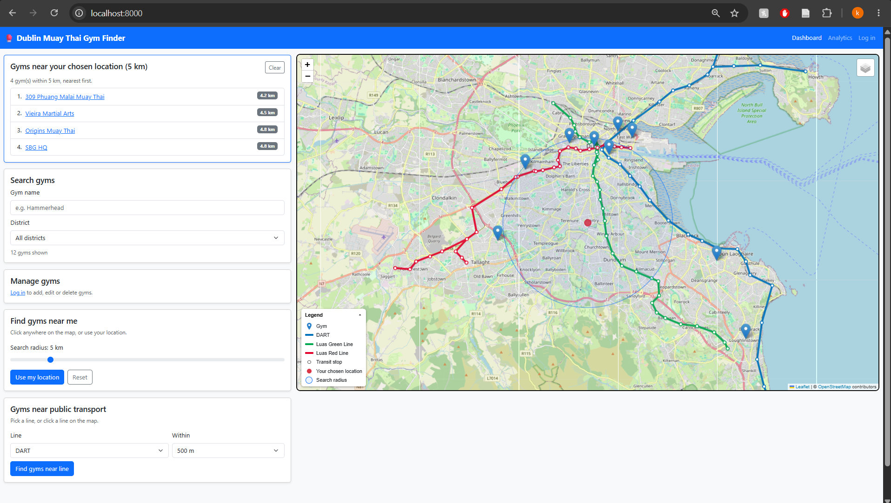
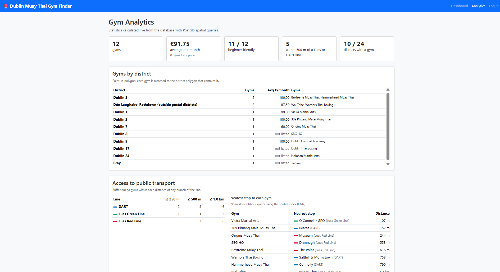
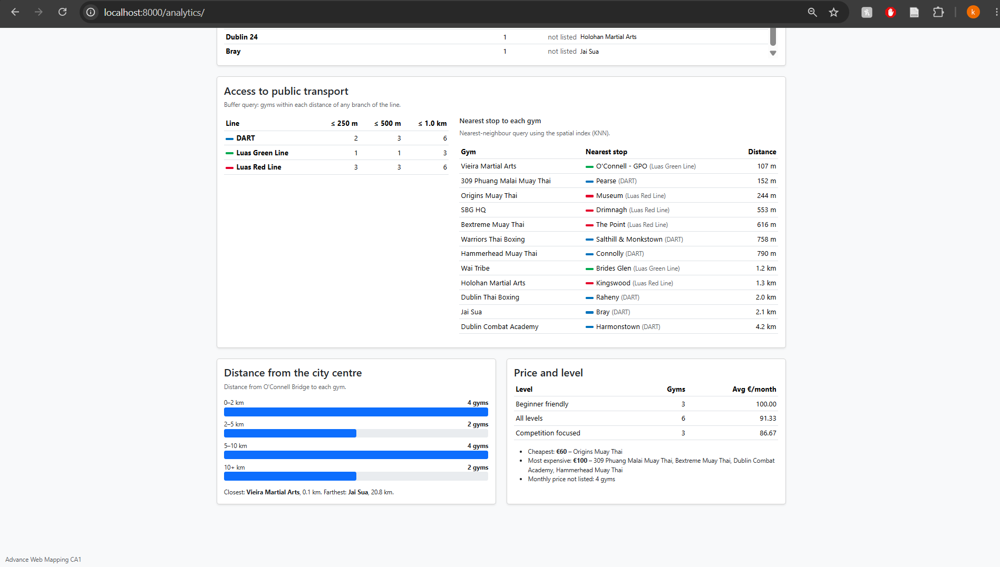
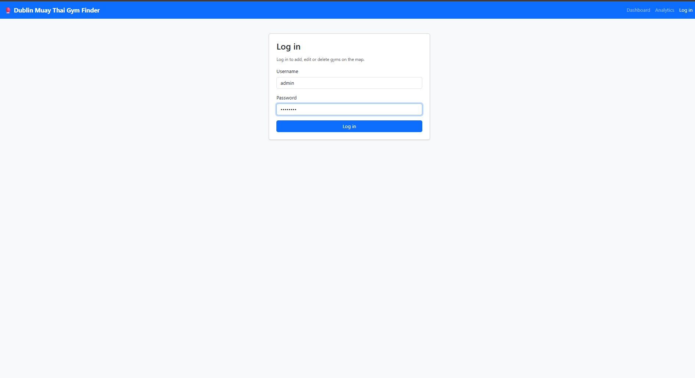
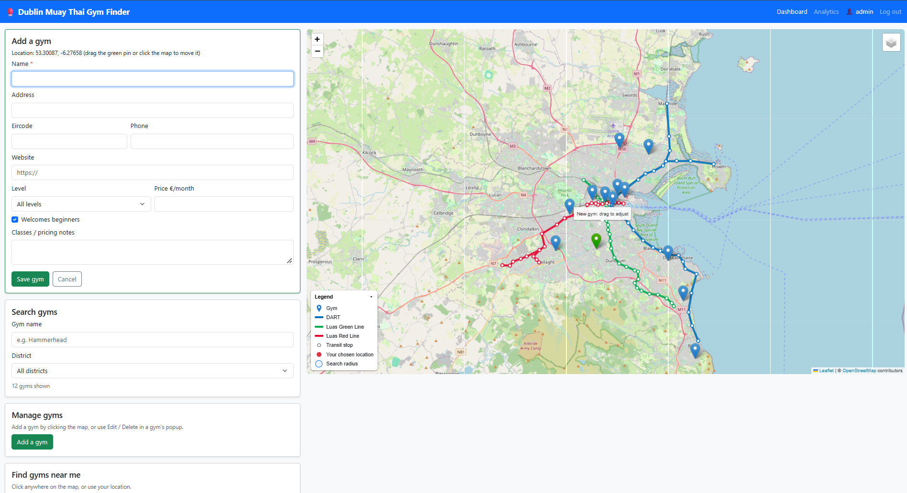

# Dublin Muay Thai Gym Finder

Advance Web Mapping CA1

## Description and Features
I built a web app for finding Muay Thai gyms around Dublin. The gyms are shown on a Leaflet map along with the Luas Red and Green lines, the DART and the Dublin post districts.

To find gyms , click anywhere on the map. To find gyms near public transport, pick a line in the transport card or just click on a line on the map. To see the gyms in a district, choose one from the dropdown. You also search by name.

Once you log in you can add, edit and delete gyms straight from the map. To add a gym, press "Add a gym", click on the map where the gym is and fill in the form. You can drag the green pin if it isn't in quite the right place. To edit or delete a gym, click on its marker and use the buttons in the popup. Each gym's district is worked out automatically from its location when it's saved.

There's also an analytics page with stats about the gyms, like how many are in each district, how many are near each Luas or DART line, the nearest stop to each gym, and prices by level.

## Setup Instructions

Docker is requierd. Create a .env file in the same folder as compose.yaml with the following variables: POSTGRES_DB, POSTGRES_USER, POSTGRES_PASSWORD, DATABASE_HOST, DATABASE_PORT, PGADMIN_DEFAULT_EMAIL, PGADMIN_DEFAULT_PASSWORD and DJANGO_SECRET_KEY.

Then start everything with:

docker compose up -d --build

When the web container starts it runs the migrations and loads the seed data automatically if the database is empty,  giving you 12 gyms and transport lines. The app runs at http://localhost:8000 and pgAdmin at http://localhost:5050. To look at the database in pgAdmin, add a new server with the host name db, port 5432, and the database details from your .env file.

You'll need an account to add gyms, create with:

docker compose exec web python manage.py createsuperuser

I made a test account with the username: admin and the password: admin123.

The default compose file is set up for production, so gunicorn serves the app, DEBUG is off and the code is built into the image. While I was developing I used the dev compose file instead, which runs Django's development server with DEBUG on and mounts the code so changes show up without rebuilding:

docker compose -f compose.yaml -f compose.dev.yaml up -d --build

The assignment only required a local deployment, so I haven't put it on a cloud server. To deploy it to the cloud, you would run the same containers on a server with Docker installed, set DJANGO_ALLOWED_HOSTS to the server's domain, serve it over HTTPS and set DJANGO_USE_HTTPS to True to turn on the HTTPS-only security settings.

## Technology Stack

The database is PostgreSQL 16 with PostGIS 3.4. The gyms and stops are stored as Points, the Luas and DART lines as MultiLineStrings and the districts as MultiPolygons, and every spatial column has a GiST index. The district boundaries come from OpenStreetMap.

The back end is Django 5.2 using GeoDjango and Django REST Framework, with DRF-GIS to return the data as GeoJSON. Django follows the MVC pattern, with the models holding the data, the URLs and views acting as the controller, and the templates and API responses as the view. In production it runs on gunicorn, and WhiteNoise serves the static files.

The front end uses Leaflet with OpenStreetMap tiles for the map and Bootstrap 5 for the layout, so it works on desktop, tablet and mobile.

Everything runs in Docker, with separate containers for Django, PostGIS and pgAdmin on a custom Docker network with its own subnet (172.28.0.0/24). The database has no public port, so only the other containers can connect to it, and the data is stored in Docker volumes so it survives restarts.

## Screenshots

## Limitations

The Luas and DART lines are drawn as straight lines between the stops, so they don't follow the exact track, and a few of the stop locations are approximate because the wrong coordinates are given on google maps.

The app only runs locally over HTTP, so the HTTPS security settings are turned off. They're ready to be switched on if it was deployed to a server with HTTPS.

## API Documentation

GET /api/gyms/ returns all the gyms, and you can filter them by name, district, level, beginner_friendly, price_min, price_max or search. POST /api/gyms/ adds a new gym, and /api/gyms/{id}/ gets, updates or deletes a single gym. You need to be logged in to add or change gyms, and you can only change the ones you created unless you're a staff user.

The spatial endpoints are GET /api/gyms/nearby/?lat=53.35&lng=-6.26&distance=5, a proximity search for gyms within a distance in kilometres, GET /api/gyms/near_line/?line=1&distance=500, a buffer search for gyms within a distance in metres of a transit line, and POST /api/gyms/within_bounds/, which takes west, south, east and north values and returns the gyms inside that box. GET /api/gyms/{id}/district/ uses a point-in-polygon query to return the district a gym is in, and GET /api/gyms/statistics/ returns a few totals.

GET /api/transit/lines/, /api/transit/stops/ and /api/districts/ return the lines, stops and districts as GeoJSON. If the input is invalid you get a 400 with a message saying what's wrong, and the API is limited to 100 requests a minute if you're not logged in.
